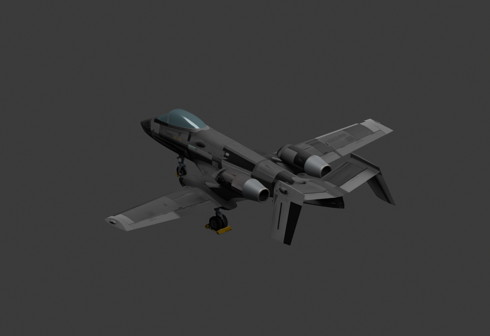

# A-19J — Jet-Powered Brawler

In vanilla, the A-19 Brawler runs on propellers.

With **A-19J**, it trades them for twin jet engines while keeping its familiar airframe, armour and weapons—a fresh take on a dependable aircraft.

**Work in progress · Version 0.1.1 · Nuclear Option 0.34.6**

[Download A19J.dll](https://github.com/markus21alpha-dot/A19J/releases/download/v0.1.1/A19J.dll) · [Project page](https://markus21alpha-dot.github.io/A19J/) · [Report an issue](https://github.com/markus21alpha-dot/A19J/issues)

*Model render, not an in-game screenshot.*

---

## AI Disclaimer

AI assistance was used to write the mod's code, create the custom exhaust housings, rims and interior geometry, and help assemble, compile and test the mod. The project description and documentation were also prepared with AI assistance. The base aircraft model and reused game assets come from Nuclear Option.

The original game meshes, textures, sounds and other extracted assets are **not distributed** in this repository or its release. The plugin reuses assets from the user's installed game at runtime. The custom exhaust geometry is generated by the published plugin code.

---

## What it adds

- A separate **A-19J** aircraft; the original A-19 remains available.
- Two conventional jets rated at 48 kN each, with native startup, spool, sound, fuel and IR behaviour.
- Complete tapered exhaust housings, circular metal lips and recessed interiors at close and distant rendering levels.
- The familiar A-19 cockpit, armour, weapons, fuel layout and 33 airframe damage parts.
- No afterburners or thrust vectoring.

The subsonic design uses native thrust falloff above 235 m/s, reaching zero at 282 m/s. It is not a hard airspeed limiter. The displayed 920 km/h maximum is a design target, not a measured flight-test result.

## Install

Requires a legitimate installed copy of **Nuclear Option**, **BepInEx 5 Mono x64** and **Blueprinter 2.1.1**.

### NOMM

Public catalog registration is being submitted to [NOMNOM](https://github.com/KopterBuzz/NOMNOM), which supplies [NOMM](https://github.com/Combat787/NOMM). Until that submission is approved, use the manual installation below. A pending submission does not mean the mod is already in the public catalog.

### Manual

1. Close Nuclear Option.
2. Install [BepInEx 5 Mono x64](https://github.com/BepInEx/BepInEx/releases) and [Blueprinter 2.1.1](https://github.com/nikkorap/NOBlueprinter-Releases/releases/tag/2.1.1) if you do not already have them.
3. Download **A19J.dll** from this repository's [v0.1.1 release](https://github.com/markus21alpha-dot/A19J/releases/tag/v0.1.1).
4. Put it in `Nuclear Option/BepInEx/plugins/A19J/A19J.dll`.
5. Start the game normally.

Do not install a second copy of the DLL if you already have A-19J. To remove this mod, close the game and remove only its `A19J` plugin folder. Saved missions containing A-19J require the plugin to load that aircraft.

## Try it

Open **Encyclopedia → Aircraft → A-19J** to inspect the aircraft. For a flight test, add A-19J as a flyable aircraft in a single-player Mission Editor mission and use the normal aircraft and engine-start controls.

Existing missions can restrict aircraft inventories. Registering the variant does not automatically grant it to every saved mission. Hangars whose aircraft list includes the original A-19 also receive A-19J in that list.

## Development notes

- The mod is still under development.
- Flight performance and balance are still being tested.
- Multiplayer compatibility has not been verified. This release is intended for single-player testing; it is not advertised as a client-only multiplayer mod. Do not use it to gain an advantage on servers that have not agreed to use the mod.
- Feedback and suggestions are welcome through the Issues tab.

The exact released DLL passed compilation, separate registration, prefab/reference ownership, damage-part preservation, electrical connections and live offline encyclopedia spawning. A restrained 20-second engine run-up reached approximately **47,995 N per engine** at full RPM and consumed approximately **21 kg of fuel**. All 15 existing mod files on the test installation were unchanged.

Headless checks do not assess rendered in-game appearance, perceived sound quality or full flight handling. Takeoff, landing, sustained flight, combat balance and multiplayer remain unverified. The model previews were reviewed separately.

See [test-report.json](test-report.json), [validation-evidence.txt](validation-evidence.txt) and [code-audit.json](code-audit.json) for the test scope and released DLL hash. The direct-call audit covers this plugin, not every dependency or installed mod.

## Source

The complete source is in [A19JPlugin.cs](A19JPlugin.cs). See [BUILDING.md](BUILDING.md) to rebuild it locally with the game and dependency assemblies. Nothing is obfuscated. The mod has no direct file-writing, web-request, process-launch, registry or native-library calls.

Two explicit developer environment switches enable background checks: `A19J_VALIDATE=1` and `A19J_VALIDATE_SPAWN=1`. They are unused during an ordinary launch. The test branch opens the stock offline encyclopedia and exits its test process after completion; ordinary launches do not start tests or quit automatically.

## Credits and licence

Original mod code and custom procedural exhaust geometry: **markus21alpha-dot**, developed with AI assistance. See [LICENSE](LICENSE) and [THIRD_PARTY_NOTICES.md](THIRD_PARTY_NOTICES.md). The MIT licence covers original mod content only; it does not grant rights to Nuclear Option or its assets.

This is an unofficial community mod, not affiliated with or endorsed by Shockfront Studios.
